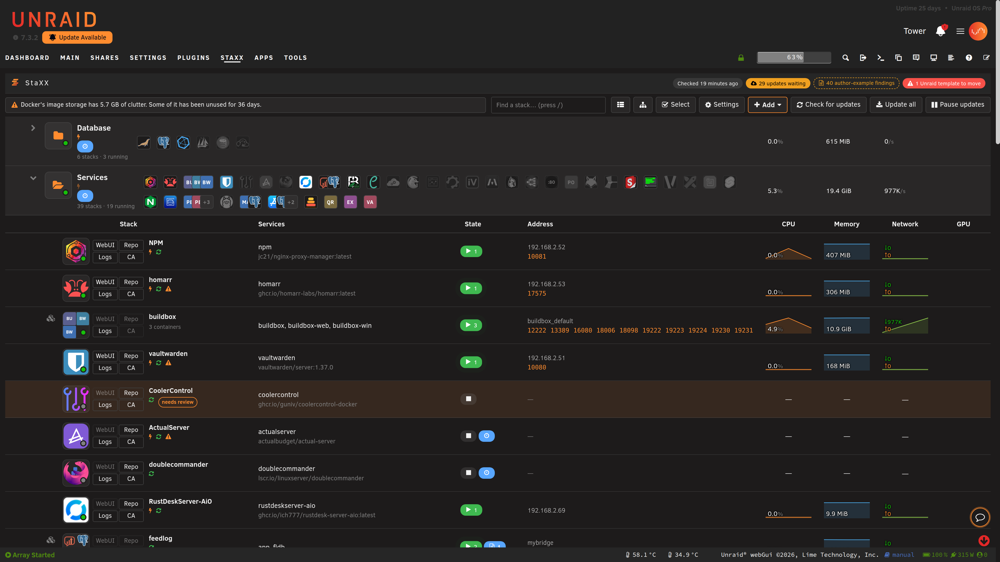
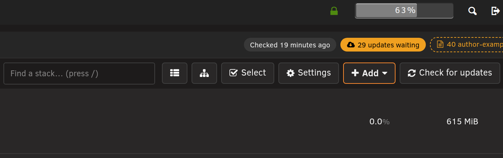
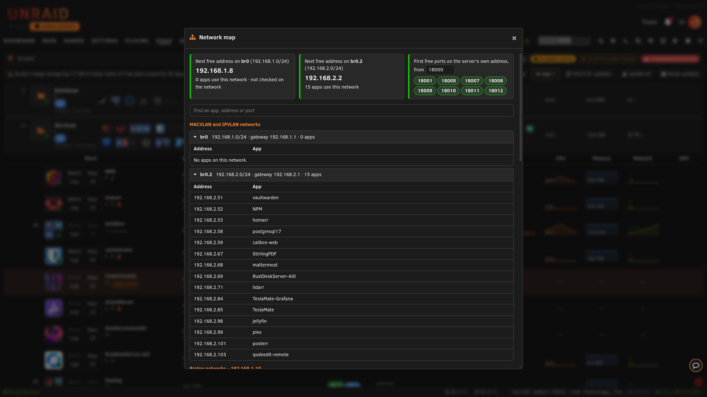
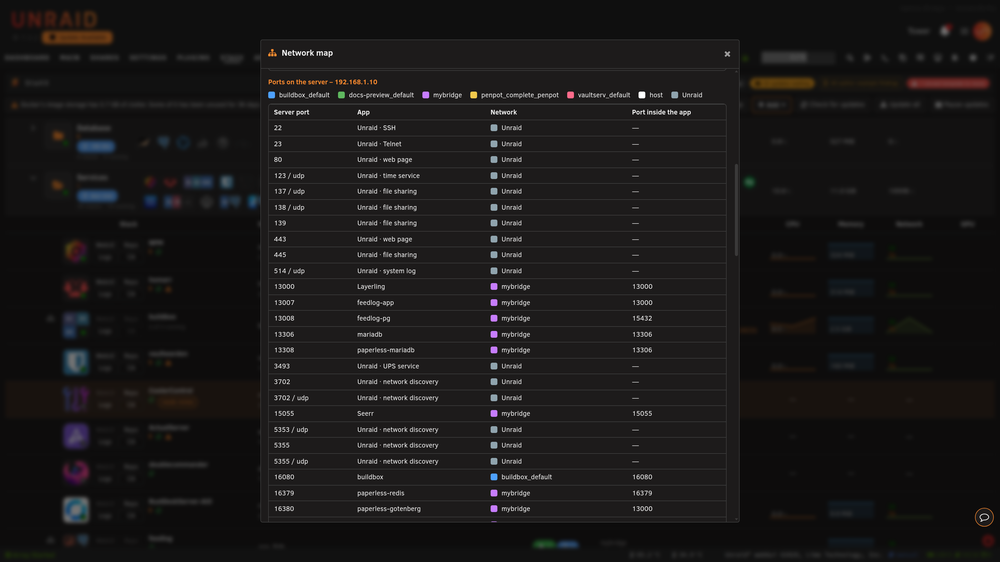

# Network map

<!-- index: 22 | finding a free address or port, and what to do when an app's address is already taken -->

[StaXX guide](README.md) › Network map

Use the **Network map** window to find a free address or port before you give one to an app. Open it
from the toolbar above [the stacks page](the-stack-list.md): it is the button with the network icon,
beside the legend button.

## The short version

1. Press the network icon in the toolbar.
2. For an app with its own address, read the next free address at the top of the window.
3. For an app that uses the server's address, type a port number to start from and pick one of the ports shown.
4. Type in the search box to find an app, an address or a port.

## What the window shows

At the top, one card for each MACVLAN or IPVLAN network, then one card for ports.

| Card | What it shows |
|---|---|
| **Next free address on** a network | The lowest address on that network that no app has. It also says how many apps use the network. |
| **First free ports on the server's own address** | The first eight port numbers, counting up from the number in the box, that nothing is using. Type another number in the box and the list follows. |

When a card says **not checked on the network**, make sure nothing else on your network uses that
address before you give it to an app.

Under the cards, a search box filters everything below it. Type part of an app's name, an address
or a port number.

Below that are the sections. A section is left out when it has nothing to show.

| Section | What it lists |
|---|---|
| **MACVLAN and IPVLAN networks** | One group for each network that gives apps their own addresses. Each group lists every address in use and the app that has it. |
| **Ports on the server – \<server address>** | Every port in use on the server's own address, in number order: the ports bridge apps have opened, the ports host-network apps use, and Unraid's own. Each row shows the app, its network and the port inside the app. |

Press a network's name in the first section to fold its group shut or open it again.

Each network has its own coloured square. The legend beside the heading says which colour is which,
and the same square sits in the **Network** column of every port. Unraid's own programs read
**Unraid ·** and the service, such as **Unraid · SSH**.

A stopped host-network app shows the ports it expects to use, tagged **expected**. When two apps want
the same port, both rows turn red and say which other app uses it. Give one of them a different port.

To find a free port, look at the card first. To see who has a port that is not free, search for it.

## When an app could not start

When an app cannot start because another app already has its fixed address, a window opens with the
app's name in its title. It shows the address, which app has it, and the next free address on that
network. It has three buttons.

| Button | What it does |
|---|---|
| **Show network map** | Closes the window and opens the network map. |
| **Open the editor** | Opens the app's stack so you can choose an address yourself. |
| **Use** *address* **and start** | Writes the free address into the app's file, then starts the app. |

**Use** *address* **and start** changes the address in the app's file. To take the change back, open
the stack and use [the History tab](editor-history.md): pick the version from before and press
**Restore into Configure**, then **Save**.

When more than one app in the stack has this problem, the window shows each one, and the button
uses every suggested address.

## Terms used here

Any word you are not sure of is in the [glossary](../glossary.md).

Back to [the StaXX guide](README.md).
